<div align="center">


<br />

<a href="https://omarmetman.vercel.app"></a>
<a href="https://t.me/omarmetman"></a>

<br />


</div>

<br />


<div align="center">



</div>

<details>
<summary><b>View the source of this character</b></summary>

```javascript
const omar = {
  origin: "Mansoura, Egypt",
  class: "Full Stack Software Developer",
  level: "5+ years in production",
  education: "Mechatronics Engineering @ Delta University",
  specialAttack: "Telegram Bots (95% mastery)",
  sideQuests: ["AI chatbots", "Offline-first mobile apps", "IoT systems"],
  achievements: ["64+ technical articles", "29 projects shipped", "1 sold product"],
  status: "OPEN FOR FREELANCE QUESTS ⚔️"
};
```

</details>

<br />


<div align="center">

<br />


<br />


<br />


<br />


<br />


<br />


<br />


</div>

<br />


<div align="center">


<br />

<a href="https://omarmetman.vercel.app/about"></a>
<a href="https://omarmetman.vercel.app/stats"></a>

</div>

<br />


<div align="center">


</div>

<br />


<div align="center">



<br />

<sub>📊 <b>THE DOSSIER</b> — rank, total stars earned, commits, pull requests and the languages most used across every public repository. Recomputed live on every page load.</sub>

<br /><br />


<br />

<sub>🔥 <b>THE STREAK</b> — consecutive days with at least one contribution. Consistency is the whole game: shipping a little every day beats heroic all-nighters.</sub>

<br /><br />


<picture>
  <source media="(prefers-color-scheme: dark)" srcset="./profile-3d-contrib/city-night.svg" />
  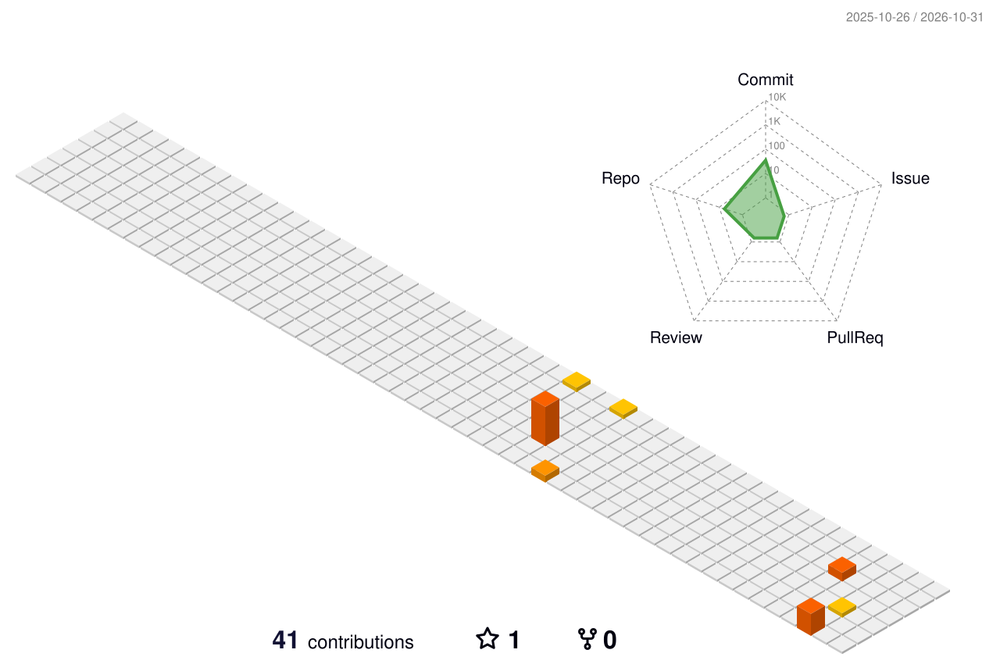
</picture>

<sub>🗺️ <b>THE LIVING CITY</b> — one full year of work rendered as an isometric hologram and rebuilt <b>daily by a GitHub Actions satellite</b> (<code>.github/workflows/profile-3d.yml</code>). Each floor tile is a day, each tower is code shipped that day. The pentagon radar scores <b>Commit / Issue / Pull Request / Review / Repo</b> — pure proof of work, with no language labels by design. The full arsenal lives in the sections above.</sub>

<br /><br />

<picture>
  <source media="(prefers-color-scheme: dark)" srcset="https://raw.githubusercontent.com/omarmetman/omarmetman/output/github-snake-dark.svg" />
  
</picture>

<sub>🐍 <b>THE SERPENT</b> — the same contribution grid, devoured cell by cell and re-released every 12 hours (<code>.github/workflows/snake.yml</code>). It only moves where there is history — a long snake is proof of consistency no badge can fake.</sub>

<br /><br />


<br />

<sub>🏆 <b>THE TROPHY VAULT</b> — milestones unlocked: stars collected, repositories forged, followers gathered. Every trophy maps to something actually shipped.</sub>

<br /><br />


<br />

<sub>〰️ <b>THE PULSE</b> — 31 days of contribution frequency as one continuous heartbeat. Flat lines are silence; spikes are launch weeks.</sub>

</div>

<br />


<div align="center">

<a href="https://omarmetman.vercel.app/projects/whisper"></a>

<a href="https://whisper-4th1.vercel.app/"></a>
<a href="https://whisper-4th1.vercel.app/download"></a>
<a href="https://github.com/sarahwaleedmmbadr"></a>

<a href="https://devforge-download.vercel.app/"></a>
<a href="https://baseeraa.vercel.app/"></a>

<a href="https://omarmetman.vercel.app/projects/sirat"></a>
<a href="https://omarmetman.vercel.app/projects/etman-finance"></a>

<a href="https://omarmetman.vercel.app/projects"></a>

<a href="https://omarmetman.vercel.app/blog"></a>
<a href="https://omarmetman.vercel.app/projects"></a>
<a href="https://siraj-advice.vercel.app/"></a>

</div>

<br />


<div align="center">

<a href="https://omarmetman.vercel.app/request"></a>
<a href="https://omarmetman.vercel.app/request"></a>

<a href="https://omarmetman.vercel.app/request"></a>
<a href="https://omarmetman.vercel.app/request"></a>

<a href="https://omarmetman.vercel.app/request"></a>
<a href="https://omarmetman.vercel.app/request"></a>

<a href="https://omarmetman.vercel.app/request"></a>
<a href="https://omarmetman.vercel.app/request"></a>

<a href="https://omarmetman.vercel.app/request"></a>

</div>

<br />


<div align="center">


</div>

<br />


<div align="center">

<a href="https://t.me/omarmetman"></a>
<a href="https://t.me/omaretmanBOT"></a>
<a href="https://www.linkedin.com/in/omar-m-etman"></a>
<br />
<a href="https://x.com/omarm3tman"></a>
<a href="https://www.instagram.com/omarmetman"></a>
<a href="mailto:omarmetman90@gmail.com"></a>

<br />


</div>
